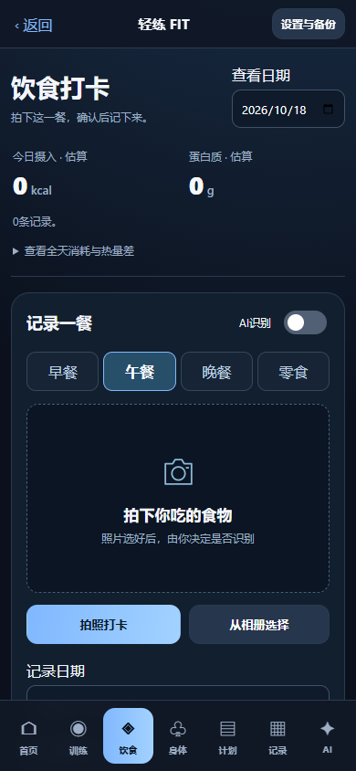
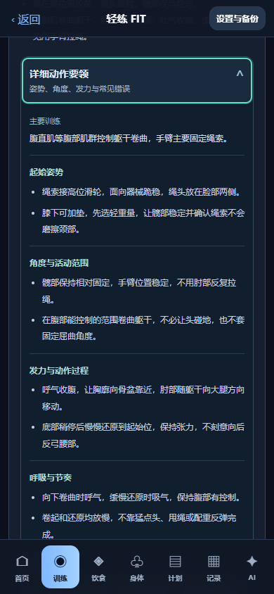

# 轻练 FIT · 0.7.2

个人健身记录 APP，支持 Android 8.0+ 和电脑浏览器。训练、饮食、体重、照片和自定义计划保存在本机；AI 由用户主动开启。本版饮食以「拍照/相册 → 识别估算 → 核对并打卡」为主流程。

**[下载 0.7.2 安卓安装包](https://github.com/fliex1124/qinglian-fit/releases/download/v0.7.2/qinglian-fit-0.7.2.apk)** · [版本发布页](https://github.com/fliex1124/qinglian-fit/releases/tag/v0.7.2) · [安装与手机 AI 设置](安卓安装说明.md)

0.7.2 增加详细动作要领，并包含 0.7.1 新增的跪姿绳索卷腹。20个动作已增加可展开的姿势、角度、发力、呼吸节奏及常见错误说明。第四天在原三动作后追加「跪姿绳索卷腹」4组 × 8–12次；旧系统计划升级/导入时自动补全，历史快照及自定义计划不变。

当前为个人测试版：已完成编译、签名、资源校验和模拟测试，**真实安卓设备的安装、系统相机、原生密钥存储及真实千问调用仍待验证**。

## 本版功能

- 四天滚动训练：胸/肱三头肌 6 动作、背/肱二头肌 6 动作、肩 4 动作、腹 4 动作。默认 4组 × 8–12次，平板支撑为 4组 × 30–60秒。
- 20 个动作有本地示范图和要领，逐动作勾选，最后确认「完成今日训练」才推进。漏练、跨日或勾选动作不会自动跳天；第四天后自行选择休息或继续下一轮。
- 删除逐组重量/次数输入与组间休息；保留独立楼梯机 40 分钟目标和实际计时。旧重量记录不清空。
- 饮食拍照打卡，支持早餐、午餐、晚餐、零食。识别结果为可修改草稿，确认后才保存；不识别也能保存照片，未知营养显示「待补充」，不当成零热量。
- 免费手动补录保留 132 条食物参考、份量计算、条码查询和全天热量/蛋白质估算。日常消耗及训练消耗均为估算。
- 体重/围度、照片对比、多套自定义计划、训练历史、JSON 完整导入导出继续可用。





预览图来自隔离的浏览器测试，非安卓真机截图或真实 AI 识别结果。

## 安卓安装与更新

从 [0.7.2 Release](https://github.com/fliex1124/qinglian-fit/releases/tag/v0.7.2) 下载 `qinglian-fit-0.7.2.apk`，在安卓文件管理器中打开。包名 `cn.local.qinglianfit`，版本代码 72，APK 约 2.76 MB，仅声明 INTERNET 权限。

已有官方提供的同签名版本时，先导出完整备份，再覆盖安装。**不要先卸载**；卸载或清除数据会删除本机记录。电脑与手机数据各自独立，需要通过备份迁移。

安装包不包含用户记录、API Key、私有签名密钥或食物模型权重。校验值和包验证信息随 Release 提供。

## 手机 AI

打开底部「AI → 配置密钥与接口」，在原生窗口输入自己的千问 API Key 及北京地域 OpenAI 兼容地址。默认聊天模型 `qwen-plus`，视觉模型 `qwen3-vl-plus`，以自己账号实际权限为准。

- 个人手机可直接连接千问，不要求电脑持续开机或自建服务器。
- 每次启动 AI 默认关闭；主动开启且逐次确认可能收费后才发送当前问题/照片，不自动上传历史。
- 密钥由 Android Keystore 加密保存在本机，不进入网页或 JSON 备份；本项目不提供共享密钥。
- 默认每日 10 次，聊天/照片/连接测试共用，失败也计次；可设置为 0 停用。次数限制不是账户金额硬预算，是否消耗免费额度以供应商控制台为准。
- 识别只是估算，保存饮食始终需要用户确认。AI 完全关闭仍能训练、记录与照片打卡。

详细步骤见 [安卓安装说明](安卓安装说明.md)。

## 电脑预览

需要 Python 3。在项目目录双击 `启动轻练FIT.cmd`，浏览器打开 [本机预览](http://127.0.0.1:8788/)。也可在 PowerShell 运行：

```powershell
$env:FIT_PORT = '8788'
python server.py
```

只监听本机。请固定浏览器和地址：不同端口、浏览器与手机不会自动共享记录。电脑端 AI 可用 `配置AI并启动.ps1` 交互输入密钥；勿将密钥提交到仓库。

## 可选的电脑本地图片模型

源码含固定版本的模型配置、来源元数据与下载脚本，**未附带约 95 MB 权重**，安卓 APK 也未内置该模型。免费手动搜索、营养计算和照片打卡不依赖模型。

电脑端实验识别使用 `Albertbeta123/resnet-50-chinese-food` 的 114 类 ResNet-50，运行需 PyTorch、Transformers、Pillow、NumPy、safetensors。准备依赖后执行 `python scripts/download-food-model.py` 下载并校验固定权重。实际推理只读本机文件，不自动联网补下权重。

该模型仅提供待确认候选，不能称重或可靠分析混合餐、用油和配料；分数不是识别正确概率。识别失败时手动补录。来源见 [模型说明](models/chinese-food/README.md) 和 [第三方素材](THIRD_PARTY_NOTICES.md)。

## 验证与已知限制

已通过：25 组核心逻辑、14 组营养、21 组存储、18 组旧安卓桥、19 组个人 AI、22 组照片流程及 14 项 Python 服务测试。浏览器训练 38 项、营养 29 项、照片流程 23 项通过；手机 320–430px 与桌面 1280px 检查无横向溢出。新增腹肌动作浏览器15项、详细动作要领浏览器153项通过。云端响应使用模拟，不能据此认定真实模型已连通。

APK 通过 ZIP 完整性、v2/v3 签名、56 个资源与源码哈希一致性检查。系统相机和 Activity 恢复、Keystore、原生确认、真实联网及不同品牌 WebView 仍待真机验证。

记录与照片受本机存储容量限制，请定期导出完整备份。暂不提供云同步、iOS、推送或应用商店自动更新。未知自定义动作没有核验图片时显示待补充。

## 开发与构建

HTML/JavaScript/CSS 前端、Python 本机服务、Java Android WebView 外壳。快速检查：

```powershell
node verify.cjs
node test-nutrition.cjs
node storage-regression.cjs
node test-mobile.cjs
node test-mobile-ai.cjs
node test-meal-photo.cjs
python -m unittest test_server -v
```

浏览器 QA 脚本只能用于隔离测试会话，会重置该测试会话的数据。不要在个人正式记录会话中运行。

`android/build.ps1` 当前按作者工作区路径读取相邻 `nasdaq-android/toolchain/` 内的 JDK 17、Android SDK platform/build-tools 34。其他机器需先调整脚本顶部工具链路径；该脚本不是开箱即用的云端构建配置。构建会在 `android/signing/` 生成或复用本机签名，该目录始终排除版本控制。自行生成的签名不能覆盖本 Release 的安装包。

未为项目整体授予开源许可证。第三方组件/图片各自遵循其来源许可，详见 [THIRD_PARTY_NOTICES.md](THIRD_PARTY_NOTICES.md)。

变更详情：[0.7.2 详细要领](变更记录_详细动作要领0.7.2.md) · [动作要领与来源](动作要领与来源.md) · [0.7.1 新增卷腹](变更记录_跪姿绳索卷腹0.7.1.md) · [0.7.0 拍照打卡](变更记录_饮食拍照打卡0.7.0.md) · [0.6.0 手机 AI](变更记录_手机AI直连0.6.0.md) · [动作图核对](动作图片核对清单.md)
